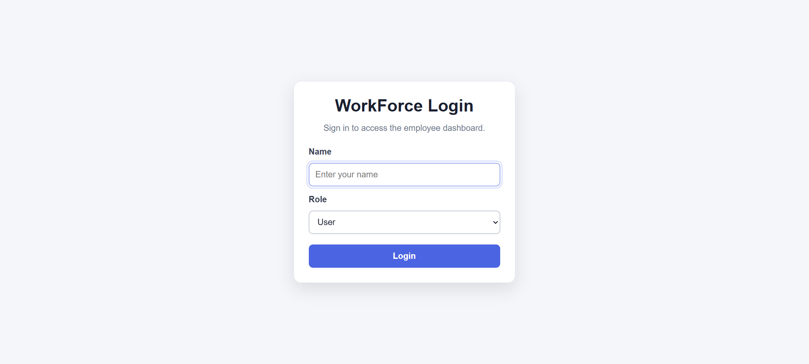
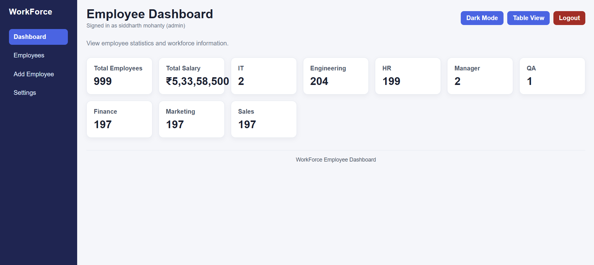
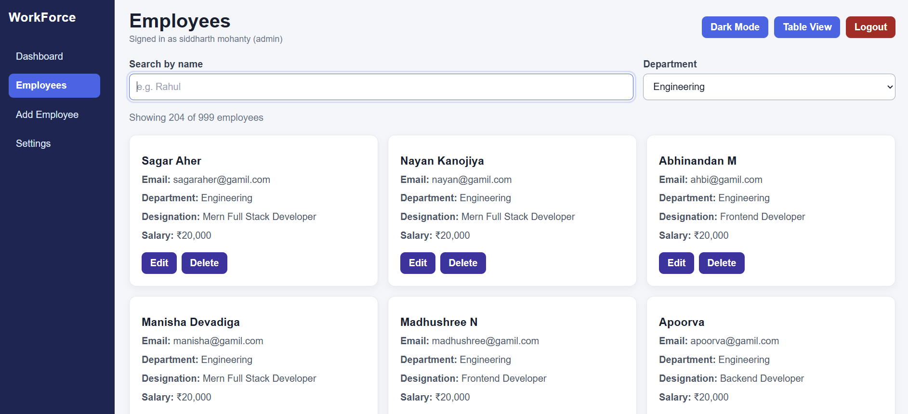
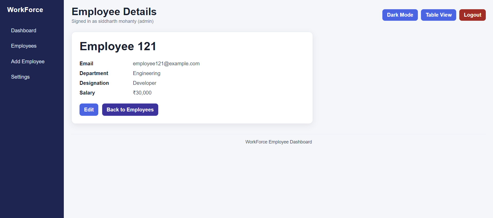
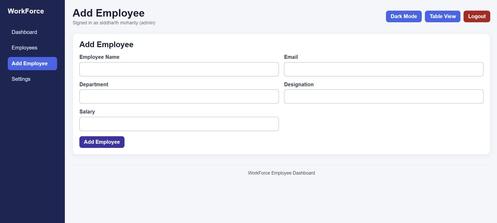
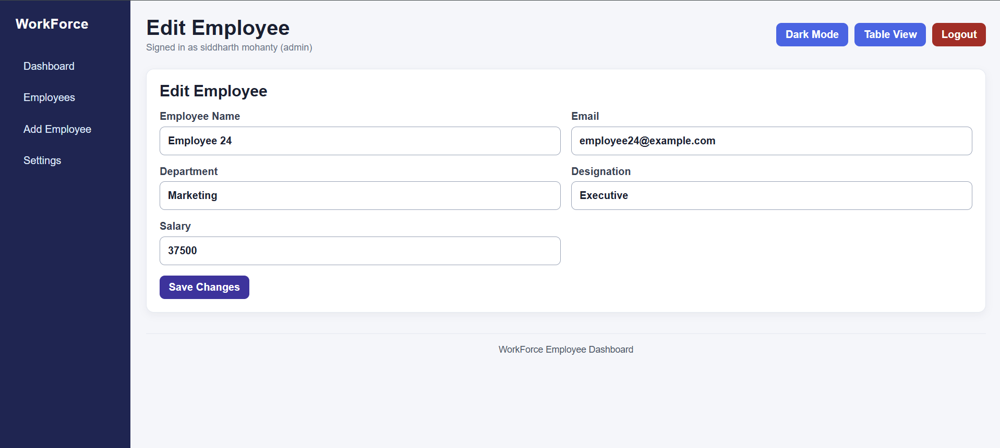
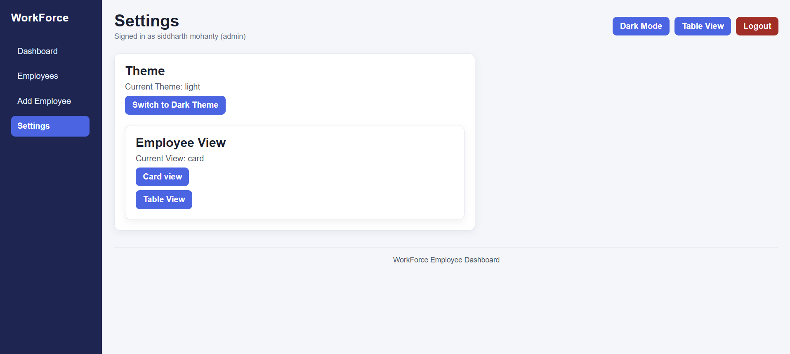
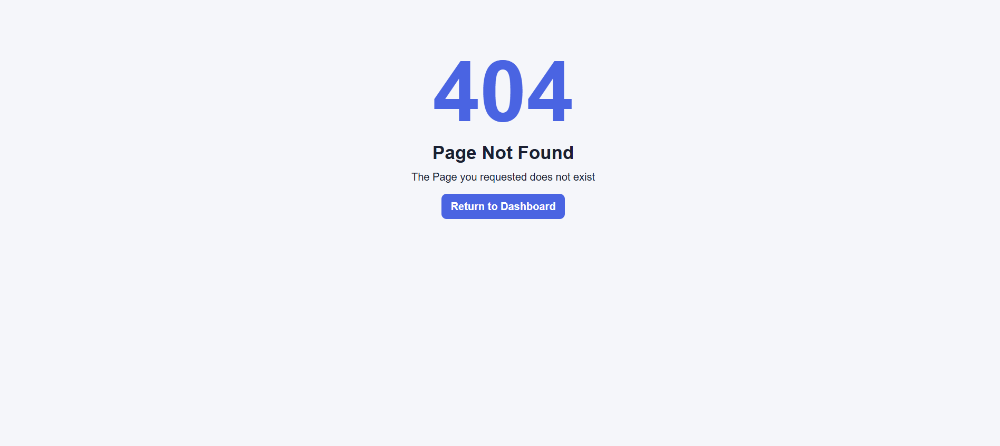
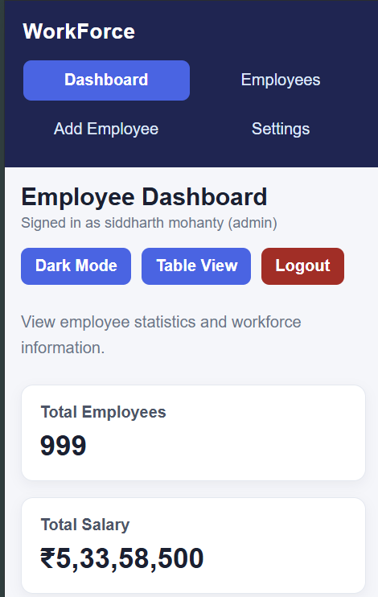

# Employee Management Dashboard

A responsive Employee Management Dashboard built with React and TypeScript. The application supports employee CRUD operations, API integration, performance optimization, centralized state management, routing, query parameters, authentication and role-based route protection.

## Features

- Fetch employees from a JSON Server API
- Add, edit and delete employees
- Search employees by name
- Filter employees by department
- Preserve search and filters in URL query parameters
- Display employee statistics and total salary
- Card and table view modes
- Light and dark themes
- Loading, success and error states
- Retry failed API requests
- Prevent duplicate form submissions and deletions
- Responsive desktop, tablet and mobile design
- Dynamic employee details routes
- Shared application layout
- Active navigation links
- Custom 404 page
- Basic login and logout
- Protected routes
- Admin-only Settings route
- Authentication persistence using localStorage

## Technologies Used

- React
- TypeScript
- React Router
- Context API
- useReducer
- Vite
- CSS3
- JSON Server
- Fetch API

## React Concepts Used

- Functional components
- Controlled forms
- Props and state
- Context API
- useReducer
- useState
- useEffect
- useRef
- useMemo
- useCallback
- React.memo
- Custom hooks
- Immutable state updates
- Conditional rendering
- List rendering and unique keys

## Routing

| Page | Route | Access |
|---|---|---|
| Login | `/login` | Public |
| Dashboard | `/dashboard` | Authenticated |
| Employees | `/employees` | Authenticated |
| Employee Details | `/employees/:id` | Authenticated |
| Add Employee | `/employees/add` | Authenticated |
| Edit Employee | `/employees/edit/:id` | Authenticated |
| Settings | `/settings` | Admin only |
| Not Found | `*` | Public |

## Routing Architecture

`BrowserRouter` is configured at the root of the application.

`AppRoutes` contains the route configuration. `AppLayout` provides a shared sidebar, header and footer. Nested pages are rendered through React Router's `Outlet`.

`ProtectedRoute` checks whether the user is authenticated before rendering protected pages. It also accepts allowed roles for role-based access.

Dynamic employee IDs are read using `useParams()`. Programmatic navigation after form submission uses `useNavigate()`.

Employee search and department filters use `useSearchParams()`. This preserves filter state when the page is refreshed or its URL is shared.

Example:

```text
/employees?search=rahul&department=IT
```

## State Management Architecture

Employee data is managed globally using Context API and `useReducer`.

Supported reducer actions:

- `SET_EMPLOYEES`
- `ADD_EMPLOYEE`
- `UPDATE_EMPLOYEE`
- `DELETE_EMPLOYEE`
- `SELECT_EMPLOYEE`

Application preferences are kept in a separate Settings Context:

- Light and dark theme
- Selected department
- Card and table view

Authentication is managed through Auth Context:

- Current user
- Authentication status
- User role
- Login
- Logout

Search text and form input values remain local because they are only needed by specific pages or components.

## Performance Optimizations

- `useMemo` for employee filtering and statistics
- `useCallback` for stable callback references
- `React.memo` for reusable employee components
- `useRef` for input focus and duplicate-request prevention
- Local filtering to avoid unnecessary API calls
- AbortController to cancel obsolete fetch requests
- Tested using a dataset of more than 1,000 employees
- Analyzed using React Developer Tools Profiler

## Project Structure

```text
src/
├── components/
│   ├── layout/
│   │   ├── AppLayout.tsx
│   │   └── Sidebar.tsx
│   ├── DepartmentFilter.tsx
│   ├── EmployeeCard.tsx
│   ├── EmployeeForm.tsx
│   ├── EmployeeList.tsx
│   ├── EmployeeStats.tsx
│   ├── Header.tsx
│   ├── ProtectedRoute.tsx
│   └── SearchBar.tsx
├── context/
│   ├── AuthContext.tsx
│   ├── EmployeeContext.tsx
│   └── SettingsContext.tsx
├── hooks/
│   ├── useAuth.ts
│   ├── useEmployeeContext.ts
│   └── useSettings.ts
├── pages/
│   ├── AddEmployee.tsx
│   ├── Dashboard.tsx
│   ├── EditEmployee.tsx
│   ├── EmployeeDetails.tsx
│   ├── Employees.tsx
│   ├── Login.tsx
│   ├── NotFound.tsx
│   └── Settings.tsx
├── reducers/
│   └── employeeReducer.ts
├── routes/
│   └── AppRoutes.tsx
├── services/
│   └── employeeService.ts
├── types/
│   └── employee.types.ts
├── App.tsx
├── index.css
└── main.tsx
```

## Installation

Clone the repository:

```bash
git clone (https://github.com/siddharth219-coder/Employee_management_dashboard.git)
```

Enter the project directory:

```bash
cd Employee_management_dashboard
```

Install dependencies:

```bash
npm install
```

## Running the Application

Start JSON Server in the first terminal:

```bash
npx json-server --watch db.json --port 3001
```

The API will run at:

```text
http://localhost:3001/employees
```

Start the React application in another terminal:

```bash
npm run dev
```

Open the URL displayed by Vite, usually:

```text
http://localhost:5173
```

## API Operations

| Operation | Method | Endpoint |
|---|---|---|
| Fetch employees | GET | `/employees` |
| Add employee | POST | `/employees` |
| Update employee | PATCH | `/employees/:id` |
| Delete employee | DELETE | `/employees/:id` |

## Demo Authentication

The login page allows selecting either a User or Admin role for demonstration.

- User: Can access Dashboard and employee pages
- Admin: Can also access Settings

The selected user is stored in localStorage so the login remains after refreshing.

This authentication is intended only for demonstrating frontend protected routes. A production application must authenticate users and enforce permissions on the backend.

## Error Handling

The application handles:

- Initial API loading errors
- Add, update and delete failures
- Invalid form values
- Invalid employee IDs
- Unauthorized route access
- Unknown routes through a custom 404 page

The initial API error screen provides a Retry button.

## Production Build

```bash
npm run build
```

The production build completes successfully with Vite and TypeScript.

## Screenshots

### Login



### Dashboard



### Employees With URL Filters



### Employee Details



### Add Employee



### Edit Employee



### Admin Settings



### Not Found



### Mobile Navigation



## Mock API Limitation

JSON Server is used as a local mock REST API. It must be running for employee API operations to work. The frontend route protection is for demonstration and does not replace backend authentication and authorization.

## Author

Siddharth Kedar Mohanty