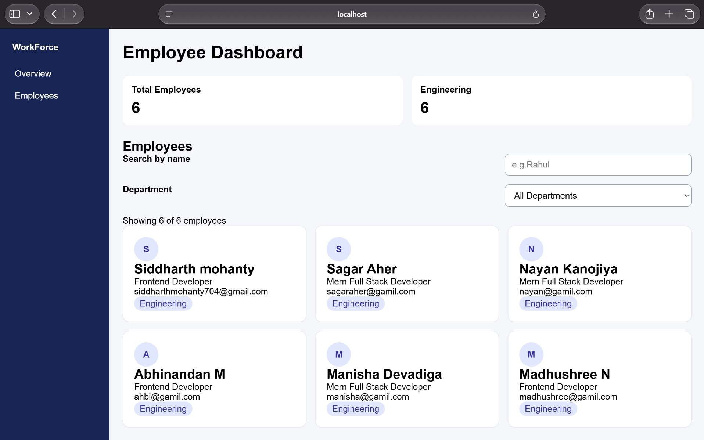

# Workforce Employee Dashboard

A responsive employee management dashboard built with React, TypeScript, Vite, and plain CSS.

## Features

- Add employees with validation for required fields, email, and salary.
- Edit employee details and delete employee records.
- Search by employee name and filter by department together.
- View total employee and department counts.
- See separate messages when the list is empty or no employees match the filters.

Employee changes are stored in React state. Refreshing the page restores the sample data.

## Run locally

```bash
npm install
npm run dev
```

Open the local URL shown in the terminal.

## Screenshots

### Desktop



### Mobile

