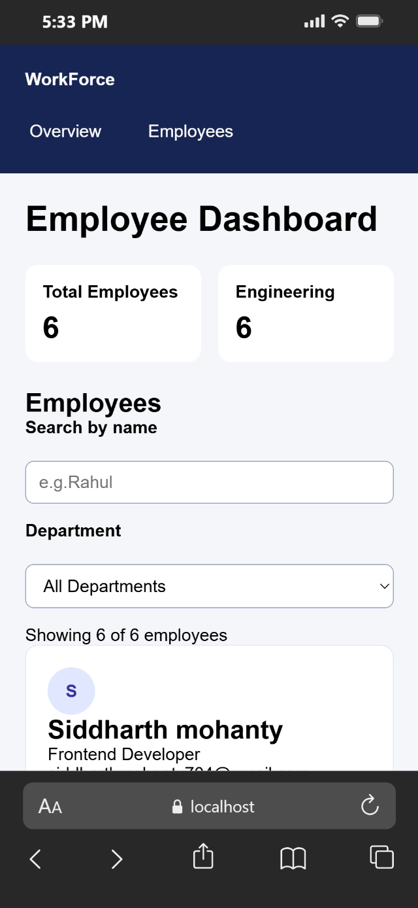
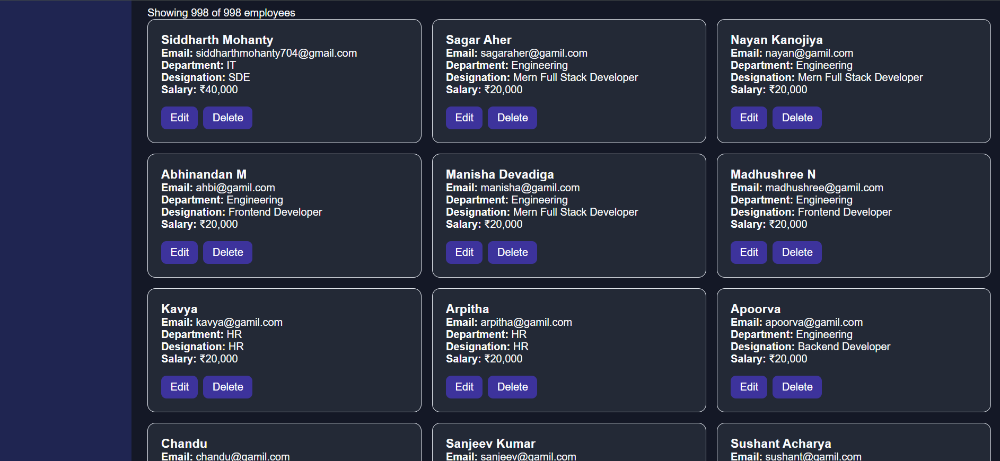
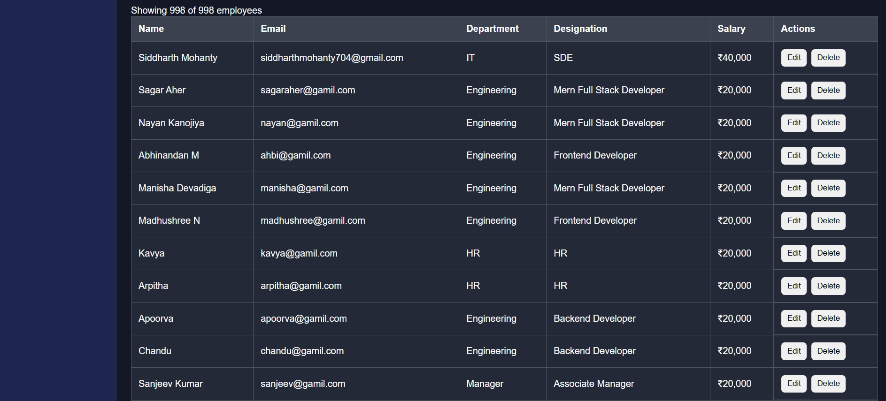

# Employee Management Dashboard

A responsive Employee Management Dashboard built with React and TypeScript. It supports complete employee CRUD operations using a JSON Server mock API.

The application uses Context API and `useReducer` for centralized employee state management. It also includes global theme, department filter and card/table view preferences.

The dashboard has been tested using 1,000 employee records and optimized using `useMemo`, `useCallback`, `useRef` and `React.memo`.

## Features

- Fetch employees from an API
- Add new employees
- Edit existing employees
- Delete employees
- Search employees by name
- Filter employees by department
- Combined search and department filtering
- Display total employee count
- Calculate total employee salary
- Display department-wise employee counts
- Controlled employee form
- Form validation and validation messages
- Loading, success and error states
- Retry failed API requests
- Prevent duplicate form submissions
- Prevent duplicate deletion requests
- Light and Dark themes
- Card and Table views
- Responsive desktop and mobile layout
- Support for 1,000 employee records
- Centralized employee state using Context API
- Typed reducer actions using TypeScript
- Separate context for application settings
- Reusable custom context hooks
- Performance optimization and Profiler analysis

## Technologies Used

- React
- TypeScript
- JavaScript
- HTML5
- CSS3
- Vite
- JSON Server
- Fetch API
- Context API
- `useReducer`
- `useState`
- `useEffect`
- `useRef`
- `useMemo`
- `useCallback`
- `React.memo`
- React Developer Tools Profiler

## Project Structure

```text
src/
├── components/
│   ├── DepartmentFilter.tsx
│   ├── EmployeeCard.tsx
│   ├── EmployeeForm.tsx
│   ├── EmployeeList.tsx
│   ├── EmployeeStats.tsx
│   ├── Header.tsx
│   └── SearchBar.tsx
│
├── context/
│   ├── EmployeeContext.tsx
│   └── SettingsContext.tsx
│
├── hooks/
│   ├── useEmployeeContext.ts
│   └── useSettings.ts
│
├── reducers/
│   └── employeeReducer.ts
│
├── services/
│   └── employeeService.ts
│
├── screenshots/
│   ├── desktop.png
│   ├── mobile.png
│   ├── api-error.png
│   ├── profiler-before.png
│   ├── profiler-after.png
│   ├── large-dataset.png
│   ├── context-light-card.png
│   ├── context-dark-table.png
│   └── context-edit-state.png
│
├── types/
│   └── employee.types.ts
│
├── App.tsx
├── index.css
└── main.tsx

db.json
generateEmployees.cjs
README.md
```

## Installation

Clone the repository:

```bash
git clone https://github.com/USERNAME/REPOSITORY.git
```

Enter the project folder:

```bash
cd Employee_management_dashboard
```

Install the dependencies:

```bash
npm install
```

## Running the Application

The React application and JSON Server must run in separate terminals.

### Start JSON Server

Open the first terminal:

```bash
npx json-server --watch db.json --port 3001
```

The employee API will be available at:

```text
http://localhost:3001/employees
```

### Start the React Application

Open another terminal:

```bash
npm run dev
```

Open the URL displayed by Vite, usually:

```text
http://localhost:5173
```

## Production Build

Create the production build with:

```bash
npm run build
```

The generated production files will be stored in the `dist` folder.

## Employee Interface

The application uses a strongly typed `Employee` interface:

```ts
interface Employee {
  id: number;
  name: string;
  email: string;
  department: string;
  designation: string;
  salary: number;
}
```

TypeScript is used for:

- Employee data
- Component props
- Context values
- Reducer state
- Reducer actions
- Callback functions
- Form data
- API responses
- Asynchronous functions
- Error handling

The application avoids using `any`.

## API Operations

| Operation | HTTP Method | Endpoint |
|---|---|---|
| Fetch employees | GET | `/employees` |
| Add employee | POST | `/employees` |
| Update employee | PATCH | `/employees/:id` |
| Delete employee | DELETE | `/employees/:id` |

The API base URL is:

```text
http://localhost:3001
```

## State Management Architecture

The application uses two separate contexts:

1. `EmployeeContext`
2. `SettingsContext`

Keeping unrelated contexts separate helps make the state easier to understand and prevents employee state from becoming mixed with UI preferences.

### Application Flow

```text
Components
    ↓
Custom Context Hooks
    ↓
Context Providers
    ↓
Reducer / Settings State
    ↓
API Service
    ↓
JSON Server
```

## Employee Context

`EmployeeContext` manages shared employee-related state and operations.

It provides:

- Employee list
- Selected employee
- Employee count
- Loading state
- Delete loading state
- API errors
- Retry functionality
- Save employee function
- Delete employee function
- Select employee function
- Reducer dispatch

Components access this context using:

```ts
const employeeContext = useEmployeeContext();
```

This avoids passing employee state and CRUD callbacks through multiple component levels.

## Employee Reducer

The employee reducer manages employee state using pure and immutable updates.

### Employee State

```ts
interface EmployeeState {
  employees: Employee[];
  selectedEmployee: Employee | null;
}
```

### Reducer Actions

The reducer supports:

- `SET_EMPLOYEES`
- `ADD_EMPLOYEE`
- `UPDATE_EMPLOYEE`
- `DELETE_EMPLOYEE`
- `SELECT_EMPLOYEE`

The actions are defined using a TypeScript discriminated union:

```ts
type EmployeeAction =
  | {
      type: "SET_EMPLOYEES";
      payload: Employee[];
    }
  | {
      type: "ADD_EMPLOYEE";
      payload: Employee;
    }
  | {
      type: "UPDATE_EMPLOYEE";
      payload: Employee;
    }
  | {
      type: "DELETE_EMPLOYEE";
      payload: number;
    }
  | {
      type: "SELECT_EMPLOYEE";
      payload: Employee | null;
    };
```

The reducer does not mutate the existing state. It returns new arrays and objects.

Examples:

```ts
employees: [...state.employees, action.payload]
```

```ts
employees: state.employees.map(/* update employee */)
```

```ts
employees: state.employees.filter(/* remove employee */)
```

## Settings Context

`SettingsContext` manages shared application preferences:

- Light or Dark theme
- Selected department
- Card or Table view

Components access these preferences using:

```ts
const settings = useSettings();
```

The settings are kept separate from employee state because they are UI preferences and do not belong in the employee reducer.

## Custom Context Hooks

### useEmployeeContext

`useEmployeeContext()` provides employee state and operations.

It throws a meaningful error when used outside `EmployeeProvider`:

```ts
throw new Error(
  "useEmployeeContext must be used inside an EmployeeProvider.",
);
```

### useSettings

`useSettings()` provides global application preferences.

It throws a meaningful error when used outside `SettingsProvider`:

```ts
throw new Error(
  "useSettings must be used inside a SettingsProvider.",
);
```

## Provider Setup

The providers wrap the application in `main.tsx`:

```tsx
<StrictMode>
  <SettingsProvider>
    <EmployeeProvider>
      <App />
    </EmployeeProvider>
  </SettingsProvider>
</StrictMode>
```

This allows child components to access both contexts through their custom hooks.

## Local State vs Global State

Not every value is stored in Context.

### Global Employee State

The following values are global because multiple components need them:

- Employee list
- Selected employee
- Employee count
- Employee API operations
- Employee API states

### Global Settings State

The following preferences are global:

- Theme
- Department filter
- View mode

### Local Component State

The following values remain local because they are used only by specific components:

- Search input
- Employee form fields
- Form validation errors
- Form saving state
- Form success message

This prevents unnecessary global state and keeps components easier to maintain.

## API Integration

The employee API service is separated from UI components.

The service contains functions for:

- Fetching employees
- Creating employees
- Updating employees
- Deleting employees

The Context Provider calls the service functions and dispatches reducer actions after successful API responses.

Example flow:

```text
EmployeeForm
    ↓
saveEmployee()
    ↓
employeeService
    ↓
JSON Server
    ↓
Reducer action
    ↓
Updated employee state
    ↓
UI re-render
```

## Loading and Error Handling

The application handles failed API requests for:

- Fetching employees
- Adding employees
- Updating employees
- Deleting employees

When the initial fetch fails, the application displays an error message and Retry button.

Unknown errors are narrowed safely:

```ts
error instanceof Error
```

`AbortController` is used to cancel obsolete employee-fetching requests when the Provider unmounts or the request is replaced.

## Duplicate Request Prevention

The employee form prevents duplicate submissions by:

- Disabling the submit button while saving
- Storing the immediate saving status in a ref

Employee deletion prevents duplicate requests by:

- Disabling Delete buttons while deleting
- Tracking the deletion request using a ref

## Search and Filtering

Search and department filtering work together.

An employee is displayed only when:

- The name matches the search text
- The department matches the selected department

Filtering happens locally and does not make unnecessary API calls.

## Theme Preference

The Header provides a Light/Dark mode button.

The selected theme is stored inside `SettingsContext` and applied to the document:

```ts
document.documentElement.dataset.theme = theme;
```

Different components respond to the global theme using CSS selectors.

## Card and Table Views

The Header provides a Card/Table view button.

The selected view is stored inside `SettingsContext`.

`EmployeeList` reads the global preference and displays either:

- Reusable employee cards
- A responsive employee table

## Performance Optimizations

The application was tested with 1,000 employee records.

### useRef

`useRef` is used to:

- Automatically focus the search input
- Store the employee form section reference
- Scroll to the form during editing
- Track component renders
- Prevent duplicate submissions
- Prevent duplicate deletion requests

Changing a ref does not cause a component to re-render.

### useMemo

`useMemo` is used for:

- Searching employees
- Filtering employees
- Calculating total salary
- Calculating department counts
- Creating department lists

These calculations run again only when their dependencies change.

### useCallback

`useCallback` is used for:

- Stable search callbacks
- Theme changes
- Employee selection
- Save operations
- Delete operations
- Retry functionality

### React.memo

`React.memo` is used on suitable reusable components to avoid unnecessary rendering when their props have not changed.

Memoization is not used everywhere because it also has a processing and memory cost.

## Large Employee Dataset

Generate at least 1,000 employees with:

```bash
node generateEmployees.cjs
```

Expected output:

```text
1000 employees generated successfully.
```

Restart JSON Server after generating the data.

## Performance Observations

### Before Optimization

Before optimization, updates in `App` caused multiple child components and employee cards to render again.

The initial Profiler recording used a small employee dataset.

### After Optimization

After optimization:

- Statistics avoid unrelated rendering
- Expensive calculations depend on correct dependencies
- Stable callbacks support memoized components
- Unchanged child components can avoid rendering
- Search and filtering support 1,000 records
- `EmployeeList` remains the most expensive component because it can render many records

For a production application, pagination or list virtualization would be the next performance improvement.

## Testing Checklist

The following behavior was verified:

- Adding an employee updates centralized state
- Editing updates the correct employee
- Editing does not create a duplicate employee
- Deleting removes the correct employee
- Employee count updates automatically
- Selected employee fills the edit form
- Selected employee clears after updating or deleting
- Search works
- Department filtering works
- Search and filtering work together
- Theme changes across the application
- Card and Table views work
- Retry works after an API failure
- Custom hooks throw errors outside their Providers
- The production build completes successfully

## Screenshots

### Desktop Dashboard


### Mobile Dashboard



### API Error and Retry


### Profiler Before Optimization


### Profiler After Optimization


### Large Dataset


### Context Light Card View



### Context Dark Table View



## Mock API Limitation

This project uses JSON Server as a mock REST API.

Data is stored locally inside `db.json`, so JSON Server must be running for API operations to work.

JSON Server is intended for development and demonstration. A production application would use a real backend API and database.

## Future Improvements

- Add pagination
- Add list virtualization
- Persist theme preference in local storage
- Add sorting
- Add automated component and reducer tests
- Add API caching
- Add authentication and authorization
- Add employee details pages

## Author

Siddharth Kedar Mohanty