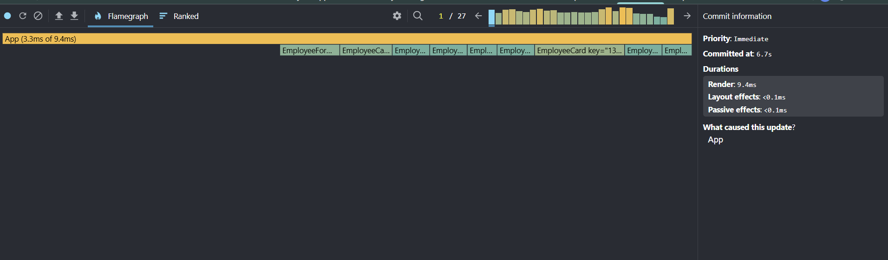
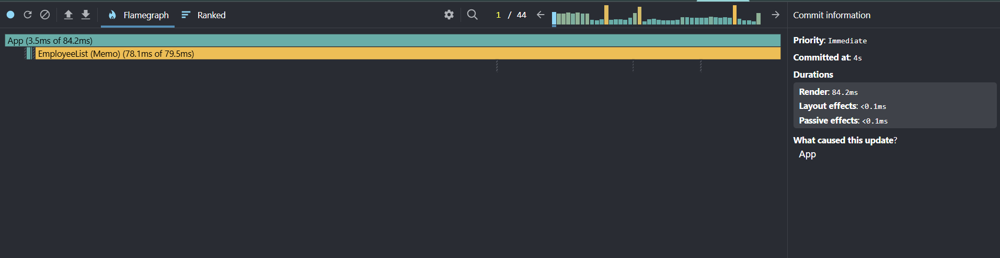
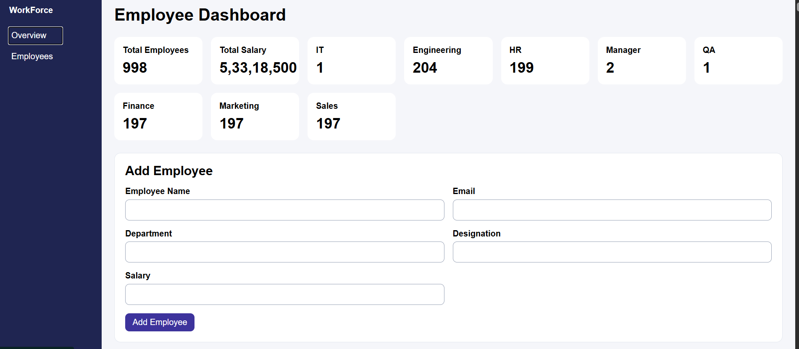

# Employee Management Dashboard

A responsive and performance-optimized Employee Management Dashboard built with React and TypeScript. It supports employee CRUD operations through a JSON Server mock REST API.

The application was tested using 1,000 employee records to observe rendering performance and optimize expensive calculations.

## Features

- Fetch employees from an API
- Add new employees
- Edit existing employees
- Delete employees
- Search employees by name
- Filter employees by department
- Combined search and department filtering
- Display total employee count
- Calculate total employee salary
- Display department-wise employee counts
- Controlled employee form with validation
- Loading, success and error states
- Retry failed API requests
- Prevent duplicate form submissions
- Prevent duplicate deletion requests
- Automatically focus the search input
- Responsive desktop and mobile design
- Reusable and properly typed React components
- Performance optimization for 1,000 employee records

## Technologies Used

- React
- TypeScript
- JavaScript
- HTML5
- CSS3
- Vite
- JSON Server
- Fetch API
- React Developer Tools Profiler

## Project Structure

```text
src/
├── components/
│   ├── DepartmentFilter.tsx
│   ├── EmployeeCard.tsx
│   ├── EmployeeForm.tsx
│   ├── EmployeeList.tsx
│   ├── EmployeeStats.tsx
│   └── SearchBar.tsx
├── hooks/
│   └── useEmployees.ts
├── services/
│   └── employeeService.ts
├── screenshots/
│   ├── desktop.png
│   ├── mobile.png
│   ├── api-error.png
│   ├── profiler-before.png
│   ├── profiler-after.png
│   └── large-dataset.png
├── types/
│   └── employee.types.ts
├── App.tsx
├── index.css
└── main.tsx

db.json
generateEmployees.cjs
```

## Installation

Clone the repository:

```bash
git clone (https://github.com/siddharth219-coder/Employee_management_dashboard.git)
```

Enter the project folder:

```bash
cd Employee_management_dashboard
```

Install the dependencies:

```bash
npm install
```

## Running the Application

The React application and JSON Server must run in separate terminals.

### Start JSON Server

Open the first terminal:

```bash
npx json-server --watch db.json --port 3001
```

The employee API will be available at:

```text
http://localhost:3001/employees
```

### Start the React Application

Open another terminal:

```bash
npm run dev
```

Open the URL displayed by Vite, usually:

```text
http://localhost:5173
```

## Production Build

Create a production build with:

```bash
npm run build
```

The generated production files will be stored in the `dist` folder.

## API Operations

| Operation | HTTP Method | Endpoint |
|---|---|---|
| Fetch employees | GET | `/employees` |
| Add an employee | POST | `/employees` |
| Update an employee | PATCH | `/employees/:id` |
| Delete an employee | DELETE | `/employees/:id` |

The API base URL is:

```text
http://localhost:3001
```

## TypeScript Implementation

The application uses an `Employee` interface consistently:

```ts
interface Employee {
  id: number;
  name: string;
  email: string;
  department: string;
  designation: string;
  salary: number;
}
```

TypeScript is used for:

- Employee data
- Component props
- State variables
- Callback functions
- Form data
- Asynchronous functions
- API responses
- Error handling

The application avoids using `any`.

## Custom Hook

The `useEmployees()` custom hook is responsible for:

- Fetching employees
- Storing employee data
- Managing the loading state
- Managing API errors
- Providing Retry functionality
- Cancelling obsolete fetch requests

`AbortController` is used in the effect cleanup to prevent an obsolete request from updating the application after the component unmounts.

## Error Handling

The application handles failed API requests for:

- Fetching employees
- Adding employees
- Updating employees
- Deleting employees

When the initial request fails, an error message and Retry button are displayed.

Unknown errors are narrowed safely using:

```ts
error instanceof Error
```

## Duplicate Request Prevention

The employee form disables its submit button while an API request is running.

A ref is also used to prevent immediate duplicate requests before the component has re-rendered.

The Delete button is disabled while deletion is in progress to prevent duplicate deletion requests.

## Performance Optimizations

The application was tested with 1,000 employee records to identify expensive calculations and unnecessary component re-renders.

### useRef

`useRef` is used to:

- Automatically focus the employee search input after API loading finishes
- Store a reference to the employee form section
- Scroll to the form when an employee is selected for editing
- Track the number of App renders
- Store mutable values without causing re-renders
- Prevent duplicate deletion requests

Changing a ref does not cause a component to re-render because React does not use ref values to generate the user interface.

### useMemo

`useMemo` is used for:

- Searching employees by name
- Filtering employees by department
- Calculating total employee salary
- Calculating department-wise employee counts
- Creating a stable department array

These values are recalculated only when their required dependencies change.

### useCallback

`useCallback` provides stable function references for:

- Adding an employee
- Updating an employee
- Deleting an employee
- Selecting an employee for editing
- Updating the search value
- Updating the department filter

Stable callbacks are useful when functions are passed to memoized child components.

### React.memo

`React.memo` is applied to appropriate components:

- `EmployeeCard`
- `EmployeeList`
- `DepartmentFilter`
- `EmployeeStats`

It performs a shallow comparison of props and can prevent a component from rendering when its props have not changed.

`React.memo` does not prevent every render. A component still renders when its props, state or consumed context change.

## Large Employee Dataset

The project includes a script that generates at least 1,000 employees for performance testing.

Run:

```bash
node generateEmployees.cjs
```

Expected output:

```text
1000 employees generated successfully.
```

After generating the data, restart JSON Server.

## Performance Observations

### Before Optimization

Before optimization, an update in `App` caused multiple child components and employee cards to render again.

The initial Profiler recording showed:

- `App` and multiple child components rendering
- Approximately 27 recorded commits
- A selected render duration of approximately 9.4 ms
- A small employee dataset was used

### After Optimization

After optimization:

- Employee statistics avoid rendering when only the search value changes
- Department controls avoid unrelated renders
- Expensive calculations run only when their dependencies change
- Stable callbacks work with `React.memo`
- Unchanged employee cards can avoid unnecessary rendering
- The application supports searching and filtering 1,000 records

The optimized Profiler recording with 1,000 employees showed:

- Total selected render: approximately 84.2 ms
- `App`: approximately 3.5 ms
- `EmployeeList`: approximately 78.1 ms

`EmployeeList` was identified as the most expensive component because it can render up to 1,000 employee cards.

For a production application, pagination or list virtualization would be the next optimization.

The before-and-after durations are not directly compared because the original recording used a small dataset while the optimized recording used 1,000 records.

## Why Memoization Was Not Used Everywhere

Memoization also has a processing and memory cost. It was applied only where:

- A calculation can become expensive with a large dataset
- Stable references help memoized child components
- A component can avoid meaningful unnecessary rendering

Simple values and inexpensive operations were not memoized unnecessarily.

## Screenshots

### Desktop Dashboard


### Mobile Dashboard


### API Error and Retry


### Profiler Before Optimization



### Profiler After Optimization



### Dashboard with 1,000 Employees



## Mock API Limitation

This project uses JSON Server as a mock REST API.

The data is stored locally in `db.json`, so JSON Server must be running for API operations to work.

JSON Server is intended for development and demonstration. A production application would use a real backend API and database.

## Future Improvements

- Add pagination
- Add list virtualization
- Add sorting
- Add automated component tests
- Add API request caching
- Add employee details pages
- Add authentication and authorization

## Author

Siddharth Kedar Mohanty